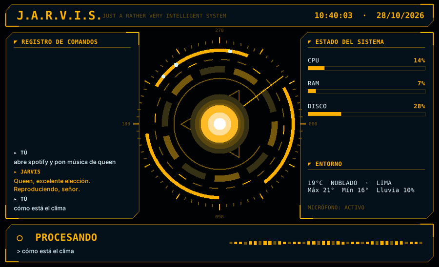
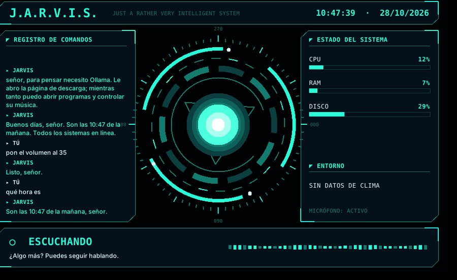
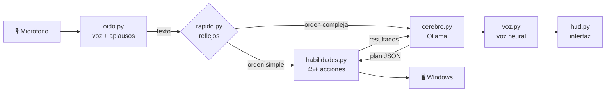

<div align="center">


# J.A.R.V.I.S. 2.0

**Just A Rather Very Intelligent System** — mi asistente de voz para Windows inspirado en Iron Man


*Le hablo, me entiende y controla mi PC. IA 100 % local y gratuita.*

</div>

---

## ✨ Vista previa

<div align="center">
<br>
<sub>Pensando (modo dorado)</sub><br><br>
<br>
<sub>Conversando — registro de comandos, sistemas en vivo y ecualizador de voz</sub><br><br>
<br>
<sub>Reactor flotante en reposo (clic para hablar)</sub>
</div>

## 🚀 Características

| | |
|---|---|
| 🎙️ **Activación por voz** | "Jarvis, …", doble aplauso 👏👏, `Ctrl+Alt+J` o clic en el reactor |
| 🧠 **Cerebro local** | Ollama + Qwen 2.5 (elige 3B o 7B según tu RAM). Sin pagar APIs |
| 🗣️ **Voz neural** | Voces de Microsoft en español, con respaldo sin internet |
| 💬 **Conversación continua** | Después de responder te sigue escuchando, sin repetir "Jarvis" |
| 🖥️ **HUD holográfico** | Reactor animado que reacciona a tu voz, colores por estado |
| ⚡ **Reflejos instantáneos** | Volumen, música y apps sin esperar a la IA |
| 🧩 **45+ habilidades** | Apps, web, sistema, archivos, info, productividad |
| 💾 **Memoria** | Recuerda datos tuyos para siempre |
| 🎓 **Aprende** | Le enseñas comandos y rutinas nuevas por voz |
| 👁️ **Visión** | "¿Qué hay en mi pantalla?" con el modelo `moondream` |
| 🔒 **Seguro** | Confirma por voz antes de apagar, enviar o borrar |

## 🗣️ Ejemplos

```
"Jarvis, abre Spotify y pon música de Queen"
"Jarvis, volumen al 30"                      "Jarvis, ¿cómo está el clima?"
"Jarvis, recuérdame en 20 minutos sacar la ropa"
"Jarvis, anota pan y leche en la lista de compras"
"Jarvis, busca el informe de historia" → "ábrelo"
"Jarvis, mándale un WhatsApp a mamá diciendo que ya voy"
"Jarvis, ¿a cuánto está el dólar?"           "Jarvis, ¿qué hay en mi pantalla?"
"Jarvis, cuando te diga modo cine, pausa todo, baja el brillo y abre Netflix"
"Jarvis, activa el modo gamer"
```

## 🏗️ Arquitectura



| Archivo | Qué hace |
|---|---|
| `jarvis.py` | Núcleo: conversación, arranque, bandeja |
| `oido.py` | Micrófono, detección de voz y de aplausos |
| `voz.py` | Voz neural y voz de Windows de respaldo |
| `cerebro.py` | Personalidad, prompt y conexión con Ollama |
| `rapido.py` | Órdenes instantáneas y comandos aprendidos |
| `habilidades.py` | Todas las acciones sobre la PC e internet |
| `hud.py` | Interfaz holográfica y reactor flotante |
| `datos/` | Configuración y ejemplos de entrenamiento |

## 📦 Instalación

1. Instala **[Python 3.12](https://www.python.org/downloads/)** (marca *Add Python to PATH*).
2. Instala **[Ollama](https://ollama.com/download/windows)**.
3. Ejecuta `instalar.bat` — instala librerías y descarga el cerebro según tu RAM.
4. Ejecuta `iniciar_jarvis.bat`.

### Crear el instalador `.exe`

```bat
compilar_exe.bat
```

Genera `salida\JARVIS_Setup.exe` con PyInstaller + Inno Setup: icono propio, acceso en el
escritorio y opción de iniciar con Windows.

## ⚙️ Configuración

Clic derecho en el reactor → **Configuración** (`%APPDATA%\JARVIS\config.json`):

| Clave | Ejemplo |
|---|---|
| `trato` / `nombre_usuario` | `"señor"`, `"Abner"` |
| `voz` | `es-MX-JorgeNeural`, `es-ES-AlvaroNeural`, `es-PE-AlexNeural` |
| `ciudad` | `"Lima"` |
| `contactos` | `{"mamá": "+51999999999"}` |
| `rutinas` | modo gamer, modo estudio, buenas noches… |
| `modelo` | `auto`, `qwen2.5:7b`, `qwen2.5:3b` |
| `segundos_conversacion` | `7` (0 lo desactiva) |

## 🎓 Entrenamiento

- **Por voz:** *"cuando te diga X, haz Y"* crea un comando nuevo al instante.
- **Con ejemplos:** menú → *Entrenar (mis ejemplos)* y agregas pares orden → respuesta.
- **Memoria:** *"recuerda que…"* / *"olvida…"*.

## 🛠️ Atajos

| Atajo | Acción |
|---|---|
| `Ctrl+Alt+J` | Hablar con JARVIS |
| `Ctrl+Alt+S` | Callarlo |
| Clic en el reactor | Hablar / callar |
| Clic derecho | Menú |

## 🧰 Problemas comunes

- **No me escucha:** revisa el micrófono predeterminado de Windows.
- **Se activa solo con ruidos:** sube `sensibilidad_aplauso`.
- **Responde lento:** usa `qwen2.5:3b` en PCs con poca RAM.
- **Registro:** `%APPDATA%\JARVIS\jarvis.log`.

---

<div align="center">
Hecho con ☕ por <a href="https://github.com/AbnerGA7">AbnerGA7</a> · Lima, Perú
</div>
