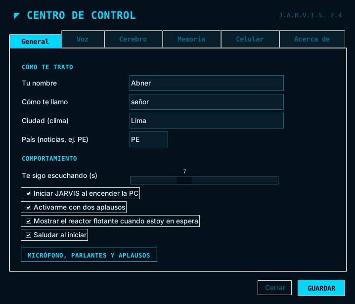
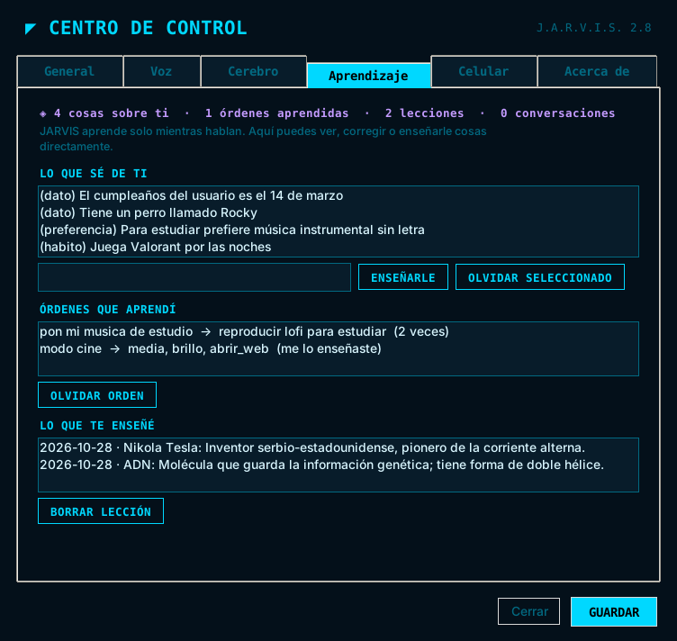
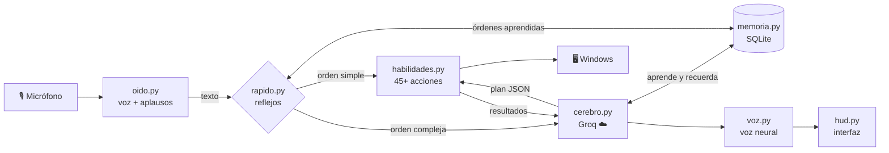
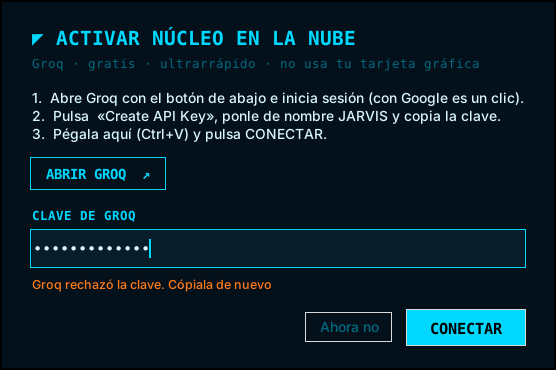

<div align="center">


# J.A.R.V.I.S. 2.0

**Just A Rather Very Intelligent System** — mi asistente de voz para Windows inspirado en Iron Man


*Le hablo, me entiende y controla mi PC. IA en la nube, gratis y sin gastar mi tarjeta gráfica.*

</div>

---

## ✨ Vista previa

<div align="center">
<br>
<sub>Pensando (modo dorado)</sub><br><br>
<br>
<sub>Conversando — registro de comandos, sistemas en vivo y ecualizador de voz</sub><br><br>
<br>
<sub>Reactor flotante en reposo (clic para hablar)</sub><br><br>
<br>
<sub>Centro de control: toda la configuración sin tocar archivos</sub><br><br>
<br>
<sub>Aprendizaje: lo que JARVIS sabe de mí, las órdenes que aprendió solo y lo que me enseñó</sub>
</div>

## 🚀 Características

| | |
|---|---|
| 🎙️ **Activación por voz** | "Jarvis, …", doble aplauso 👏👏, `Ctrl+Alt+J` o clic en el reactor |
| ☁️ **Cerebro en la nube** | Groq con el mejor modelo de tu cuenta (p. ej. GPT-OSS 120B): responde en menos de 1 s, gratis |
| 🎮 **Cero impacto al jugar** | No usa GPU; JARVIS ocupa ~200 MB de RAM |
| 🔁 **Respaldo automático** | Groq grande → Groq rápido → Google Gemini, sin que lo notes |
| 🧭 **Elige modelos solo** | Consulta qué modelos tiene tu cuenta y usa el mejor disponible |
| 🗣️ **Voz neural** | Jorge (Microsoft) gratis e ilimitada; opcional ElevenLabs con voces británicas de mayordomo |
| 💬 **Conversación continua** | Después de responder te sigue escuchando, sin repetir "Jarvis" |
| 🖥️ **HUD holográfico** | Reactor animado que reacciona a tu voz, colores por estado |
| ⚡ **Reflejos instantáneos** | Volumen, música y apps sin esperar a la IA |
| 🧩 **45+ habilidades** | Apps, web, sistema, archivos, info, productividad |
| 🧠 **Aprendizaje mutuo** | Guarda en una base de datos lo que aprende de ti y lo que te enseña |
| 🔁 **Órdenes que aprende solo** | Si le pides algo dos veces, a la tercera lo hace al instante; «así no» lo corrige |
| 📚 **Lecciones y repasos** | «¿Qué aprendimos hoy?» y «Hazme un repaso»: te pregunta lo que te enseñó |
| 🧵 **No pierde el hilo** | Recuerda la conversación aunque reinicies la PC |
| 🎓 **Le enseñas** | Comandos y rutinas nuevas por voz o desde el Centro de control |
| 🎵 **Spotify de verdad** | Busca y da play en la app de Spotify; videos y tutoriales en YouTube |
| 🌐 **Lee páginas** | «Resúmeme esta página» lee la pestaña que tienes abierta |
| 👁️ **Visión** | "¿Qué hay en mi pantalla?" con Gemini |
| 🎛️ **Centro de control** | Voz (con vista previa), cerebro, aprendizaje, música y celular en una ventana |
| ⬆️ **Se actualiza solo** | Avisa cuando hay versión nueva y se instala con un clic o diciendo «actualízate» |
| ⚡ **Habla por frases** | Empieza a responder mientras prepara el resto: se siente instantáneo |
| 👂 **Oído preciso** | Whisper de Groq para entender mejor tus órdenes en español |
| 🔔 **Notificaciones** | Los recordatorios también aparecen como notificación de Windows |
| ☀️ **Resumen del día** | «Jarvis, buenos días»: clima, recordatorios, tareas y noticias |
| 📱 **App Android** | Háblale y controla la PC desde el celular, con WiFi o datos móviles ([JARVIS-Android](https://github.com/AbnerGA7/JARVIS-Android)) |
| 🚀 **Inicia con Windows** | Arranca solo al encender la PC; se desactiva desde el menú |
| 👏 **Prueba de aplausos** | Indicador en vivo y sensibilidad ajustable |
| 🔒 **Seguro** | Confirma por voz antes de apagar, enviar o borrar |

## 🗣️ Ejemplos

```
"Jarvis, pon Queen en Spotify"               "Jarvis, ¿qué sabes de mí?"
"Jarvis, ¿qué aprendimos hoy?"               "Jarvis, hazme un repaso"
"Jarvis, resúmeme esta página"               "No, así no" (olvida la última orden aprendida)
"Jarvis, volumen al 30"                      "Jarvis, ¿cómo está el clima?"
"Jarvis, recuérdame en 20 minutos sacar la ropa"
"Jarvis, anota pan y leche en la lista de compras"
"Jarvis, busca el informe de historia" → "ábrelo"
"Jarvis, mándale un WhatsApp a mamá diciendo que ya voy"
"Jarvis, ¿a cuánto está el dólar?"           "Jarvis, ¿qué hay en mi pantalla?"
"Jarvis, cuando te diga modo cine, pausa todo, baja el brillo y abre Netflix"
"Jarvis, activa el modo gamer"
"Jarvis, buenos días"                        "Jarvis, actualízate"
"Jarvis, abre el centro de control"          "Jarvis, conecta mi celular"
```

## 🏗️ Arquitectura



| Archivo | Qué hace |
|---|---|
| `jarvis.py` | Núcleo: conversación, arranque, bandeja |
| `oido.py` | Micrófono, detección de voz y de aplausos |
| `voz.py` | Voz neural y voz de Windows de respaldo |
| `cerebro.py` | Personalidad, prompt, conexión con Groq y respaldo automático |
| `rapido.py` | Órdenes instantáneas y comandos aprendidos |
| `memoria.py` | Base de datos del aprendizaje mutuo (`%APPDATA%\JARVIS\jarvis.db`) |
| `musica.py` | Reproducción en la app de Spotify |
| `centro.py` | Centro de control |
| `servidor.py` / `tunel.py` | Enlace con la app Android (WiFi o datos móviles) |
| `habilidades.py` | Todas las acciones sobre la PC e internet |
| `hud.py` | Interfaz holográfica y reactor flotante |
| `datos/` | Configuración y ejemplos de entrenamiento |

## 📦 Instalación

1. Instala **[Python 3.12](https://www.python.org/downloads/)** (marca *Add Python to PATH*).
2. Crea tu clave gratis en **[Groq](https://console.groq.com/keys)** (inicia sesión con Google → *Create API Key*).
3. Ejecuta `instalar.bat` — instala las librerías (no descarga nada pesado).
4. Ejecuta `iniciar_jarvis.bat`.
5. La primera vez aparece esta ventana: pega tu clave y listo.

<div align="center"></div>

### Crear el instalador `.exe`

```bat
compilar_exe.bat
```

Genera `salida\JARVIS_Setup.exe` con PyInstaller + Inno Setup: icono propio, acceso en el
escritorio y opción de iniciar con Windows.

## 📱 Conectar el celular

1. Instala **JARVIS.apk** desde [JARVIS-Android → Releases](https://github.com/AbnerGA7/JARVIS-Android/releases/latest).
2. En la PC: clic derecho en el reactor → **Conectar celular** (o di *"Jarvis, conecta mi celular"*).
3. Escribe en la app el código que aparece (ej. `K7P2-QX9M`).

Funciona en la misma WiFi (conexión directa) o con datos móviles (túnel seguro de Cloudflare, sin abrir puertos).
La dirección del túnel viaja cifrada con AES-256-GCM y cada celular usa un token secreto propio.

## ⚙️ Configuración

Clic derecho en el reactor → **Centro de control** (o di *"Jarvis, abre el centro de control"*). Todo se guarda en `%APPDATA%\JARVIS\config.json`:

| Clave | Ejemplo |
|---|---|
| `trato` / `nombre_usuario` | `"señor"`, `"Abner"` |
| `voz` | `es-MX-JorgeNeural`, `es-ES-AlvaroNeural`, `es-PE-AlexNeural` |
| `velocidad_voz` / `tono_voz` | `+8%` / `-6Hz` (la voz normal de JARVIS) |
| `voz_proveedor` | `edge` (Jorge, gratis) o `elevenlabs` |
| `elevenlabs_api_key` / `elevenlabs_voz` | clave gratis de ElevenLabs · id de la voz (Daniel por defecto) |
| `musica` | `auto` (Spotify si está instalado), `spotify` o `youtube` |
| `ciudad` | `"Lima"` |
| `contactos` | `{"mamá": "+51999999999"}` |
| `rutinas` | modo gamer, modo estudio, buenas noches… |
| `proveedor` | `groq` (nube) u `ollama` (local, opcional) |
| `modelo_groq` / `modelo_groq_respaldo` | `auto` (recomendado) o el id de un modelo |
| `gemini_api_key` / `modelo_gemini` | clave de Gemini · `auto` |
| `segundos_conversacion` | `7` (0 lo desactiva) |
| `iniciar_con_windows` | `true` |
| `sensibilidad_aplauso` | umbral de volumen (también desde la prueba de aplausos) |
| `acceso_remoto` | `true` (túnel para usarlo con datos móviles) |

## 🧠 Aprendizaje mutuo

JARVIS aprende mientras hablamos y todo queda en `%APPDATA%\JARVIS\jarvis.db` (SQLite, solo en mi PC):

| Qué guarda | Cómo |
|---|---|
| **Lo que sabe de mí** | La IA anota sola gustos, datos, hábitos y correcciones, y los usa para adaptarse |
| **Órdenes aprendidas** | Si una orden termina igual dos veces, la tercera va directo, sin esperar a la IA |
| **Lecciones** | Cuando me explica algo, guarda un resumen; luego me lo repasa con preguntas |
| **Conversaciones** | Retoma el hilo aunque reinicie la PC |

- **Por voz:** *"cuando te diga X, haz Y"*, *"recuerda que…"*, *"olvida…"*, *"no, así no"*.
- **Desde el Centro de control:** pestaña *Aprendizaje* para ver, corregir o enseñarle cosas.
- **Con ejemplos:** menú → *Entrenar (mis ejemplos)* y agregas pares orden → respuesta.

## 🛠️ Atajos

| Atajo | Acción |
|---|---|
| `Ctrl+Alt+J` | Hablar con JARVIS |
| `Ctrl+Alt+S` | Callarlo |
| Clic en el reactor | Hablar / callar |
| Clic derecho | Menú |

## 🧰 Problemas comunes

- **No me escucha:** revisa el micrófono predeterminado de Windows.
- **Aplausos:** clic derecho → *Micrófono y parlantes* → prueba de aplausos; ajusta la sensibilidad hasta que detecte tus dos aplausos.
- **"Alcancé el límite gratuito":** el plan gratis de Groq tiene un tope diario; se renueva solo.
- **Cambiar las claves:** clic derecho en el reactor → *Clave de Groq* / *Clave de Gemini*.
- **Gemini (opcional):** crea tu clave gratis en [Google AI Studio](https://aistudio.google.com/apikey); activa el respaldo y la visión.
- **Voz de ElevenLabs (opcional):** crea una clave gratis en [ElevenLabs](https://elevenlabs.io/app/settings/api-keys) y pégala en *Centro de control → Voz*. El plan gratis es para uso personal y trae créditos mensuales; cuando se acaban, vuelve Jorge.
- **Spotify no da play:** deja la app de Spotify abierta e iniciada; si no logra confirmar que suena, te deja los resultados abiertos.
- **Registro:** `%APPDATA%\JARVIS\jarvis.log`.

---

<div align="center">
Hecho con ☕ por <a href="https://github.com/AbnerGA7">AbnerGA7</a> · Lima, Perú
</div>
